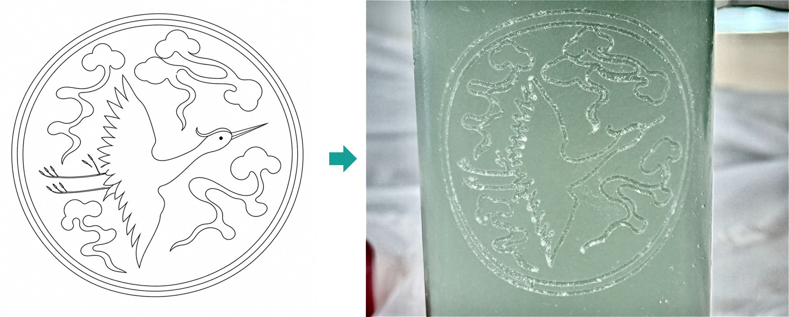
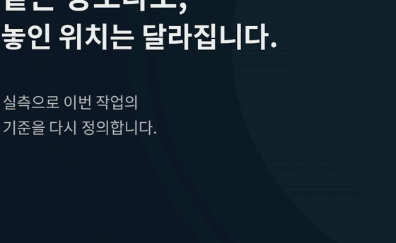
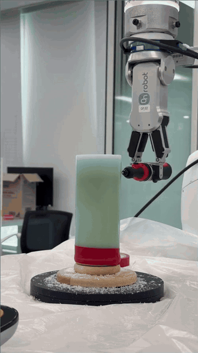
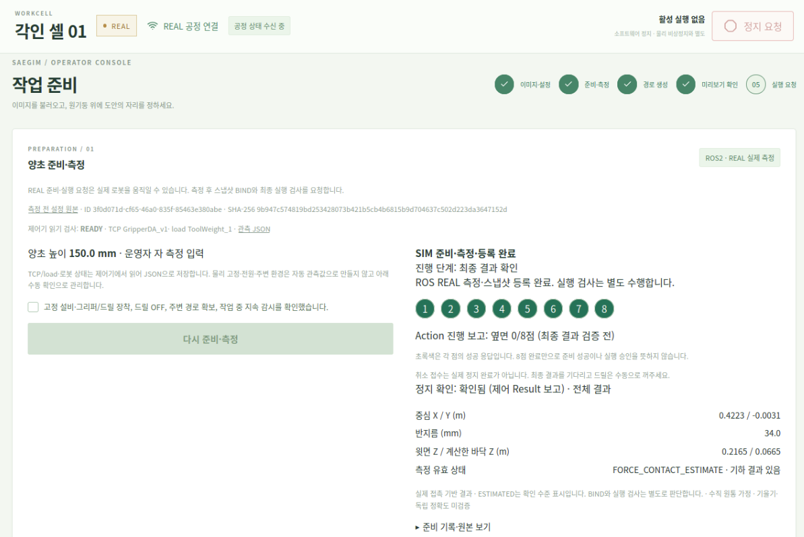
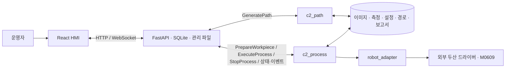

# 새김 (Saegim)

https://github.com/user-attachments/assets/fc9fabf6-7cc6-4f2d-bc93-c86c8ff6c622

**이미지 한 장을 실측한 원통 곡면의 조각 경로로 바꿔, 협동로봇이 양초에 새기는 음각 조각 자동화 시스템**

접촉 측정, 이미지에서 경로를 만드는 과정, 운영 화면, 실제 조각과 결과까지 담았습니다(1분 48초).

<p align="center">
  <br>
  <sub>입력한 도안(왼쪽)과 로봇이 양초 곡면에 새긴 실제 결과(오른쪽)</sub>
</p>

<p align="center">
  
  <br>
  <sub>양초에 직접 닿아 위치를 재는 접촉 측정(왼쪽)과 원통 표면을 따라가는 조각(오른쪽) — 실제 로봇 동작, 배속</sub>
</p>

<p align="center">
  <b>이미지 입력 → 접촉 측정 → 원통 3D 경로 생성 → 실행 전 검사 → 조각 → 이력 기록을 하나의 공정으로 연결</b><br>
  <b>실물 전 과정 6회 완료 · 반복 측정 표준편차 52 µm 이하 · 공구 이동 거리 83.6% 단축 · 공정 시험 1,057개 · 서버 시험 246개 통과</b>
</p>

<p align="center">
  
  
  
  <br>
  <sub>Ubuntu 24.04 · Python 3.12 · OpenCV · WebSocket · 2점 그리퍼 + 고정 드릴</sub>
</p>

같은 양초라도 놓인 위치는 매번 달라집니다. 새김은 로봇이 양초에 직접 닿아 중심과 반지름을 실측하고, 운영자가 올린 이미지를 그 원통 표면의 3D 조각 경로로 변환합니다. 운영자는 웹 화면에서 미리보기를 확인한 뒤 실행을 따로 요청하고, 로봇은 전 경로를 검사한 다음 조각합니다. 측정 · 설정 · 경로 · 결과는 ID와 해시로 연결해 기록합니다.

> 두산 로보틱스 ROKEY Boot Camp 9기 · 협동-1 "ROS 2를 활용한 로봇 자동화 공정 시스템 구현" · **C-2** 팀 — 이수현(팀장) · 김세은 · 노홍동 · 이시율 · 멘토 이일주 · 2026.09.17 ~ 09.30 · 담당 범위는 [팀과 역할](#팀과-역할) 참고


## 한눈에

| 문제 | 우리 방법 |
|---|---|
| 도안이 바뀔 때마다 작업 경로를 다시 짜야 한다 | 이미지와 배치값만 입력하면 조각 경로를 자동으로 생성합니다 |
| 작업물이 놓인 위치가 조금만 달라도 곡면 경로가 어긋난다 | 윗면 1점과 옆면 8점을 접촉 측정해 이번 작업의 중심 · 반지름 · 높이 기준을 다시 계산합니다 |
| 경로가 만들어졌다고 바로 로봇을 움직이면 위험하다 | 미리보기 확인 뒤 실행을 별도로 요청하고, 실행 전에 모든 경로점의 IK와 관절 한계를 검사합니다 |
| 재주문이나 원인 분석 때 당시 조건을 알 수 없다 | 측정 · 설정 · 경로 · 결과를 ID와 SHA-256 해시로 묶어 보존합니다 |

```text
INPUT              MEASURE                 PLAN                    EXECUTE
이미지 · 배치값  →  윗면 1점 · 옆면 8점   →  2D → 원통 3D 경로    →  PRECHECK · ENTRY
운영자 입력        중심 · 반지름 추정       미리보기 · 검사          조각 · 정지 · 기록
```

대상은 소량 맞춤 제작을 하는 공방과 공동 제작 공간입니다.

## 팀과 역할

| 담당 | 맡은 것 | 세부 |
|---|---|---|
| 이수현(팀장) | HMI · FastAPI · ROS 게이트웨이 | 화면 · 상태 · 오류 · 이력과 자산 추적, 준비 – 측정 – 실행 흐름 통합 |
| 김세은 | 공정 순서 · PRECHECK · ENTRY | 상태 전이, 진입 후보, 관절 검사 |
| 노홍동 | 이미지 처리 · 2D/3D 경로 | 중심선 · 해칭 · 원통 변환 · 최적화 |
| 이시율 | 양초 측정 · 도구 · 로봇 어댑터 | 8점 측정, TCP/오프셋, 조각 모션 |

각 담당자가 입력 · 출력 · 성공 · 실패 조건을 함께 맞추며 통합했습니다.

## 핵심 기술

### 접촉 측정으로 작업물 위치 계산

로봇이 양초 윗면 1점과 45° 간격의 옆면 8점에 직접 닿아 좌표를 얻고, 원 맞춤(circle fitting)으로 중심 `(cx, cy)`와 반지름 `R`을 계산합니다. 높이는 운영자가 입력한 값을 적용합니다.

| 판정 항목 | 허용 기준 |
|---|---|
| 잔차 RMS / 최대 | ≤ 0.3 mm / ≤ 0.6 mm |
| 중심 이동 / 반지름 오차 | ≤ 2 mm / ≤ 1 mm |
| 윗면 높이 편차 | ≤ 0.5 mm |

- 같은 고정 상태에서 4회 반복 측정한 표준편차는 **X 52 µm · Y 24 µm · 반지름 19 µm · 윗면 높이 8 µm**였습니다.
- 8점 전체 맞춤이 실패하면 한 점을 제외한 7점 중 품질 조건을 통과하는 해만 사용하고, 힘 한계 · 통신 상실 · 보호정지는 자동으로 재시도하지 않습니다.

### 이미지에서 원통 3D 조각 경로 생성

```text
원본 이미지 → 이진화 · 2D 선 추출 → 샘플링 · 순서 최적화 → 픽셀 → mm → 원통 3D 경로 → 검증 · 미리보기
```

- **선과 면을 구분합니다.** 선의 두께와 면적을 판별해, 가는 선은 세선화와 Bézier 곡선 근사로 중심선을 뽑고 넓은 면은 교차 해칭으로 채웁니다. 공구 폭을 반영했을 때 내부 공간이 부족하면 해칭 대신 중심선 경로로 전환합니다.
- **획 순서를 정리합니다.** 조각하지 않고 이동하는 거리를 줄이도록 획 순서를 최적화해, 오프라인 실험에서 공구 이동 거리를 **19,971 mm에서 3,269 mm로 83.6% 단축**했고 경로점은 26.4% 줄였습니다.
- **측정한 형상에 맞춰 감쌉니다.** 2D 도안을 측정한 중심 · 반지름의 원통 표면에 매핑하고, 접근(APPROACH) → 조각(CUT) → 후퇴(RETRACT) → 이동(TRAVEL) 구간으로 나눕니다.
- 가공 영역이 없거나 원통 표면 범위를 벗어난 경로는 실행 가능한 경로로 넘기지 않습니다.

### 실행 전 검사와 조각

- **입력 무결성:** 준비 기록 ID, 경로 ID · 버전, 경로 파일의 SHA-256이 요청과 일치하는지 먼저 확인합니다.
- **전 경로 검사:** 모든 경로점의 IK, 관절 한계, J6 안전 여유를 실행 전에 검사합니다.
- **후속 동작 차단:** 어느 단계든 실패하거나 정지하면 다음 로봇 동작을 호출하지 않습니다. 자동 HOME 복귀와 자동 재시작도 하지 않습니다.
- **조각 방식 선택:** 실행 중 접촉으로 깊이를 보정하는 Force Touch 방식을 실물로 시험한 뒤, 측정한 형상을 기준으로 표면 안쪽 법선 방향 0.5 mm를 적용하는 Fixed Depth 방식을 최종 선택했습니다.

### 운영 화면 · 서버 · ROS 게이트웨이

운영자는 웹 화면 하나에서 준비부터 결과 조회까지 진행합니다. 화면은 로봇 모션을 직접 지시하지 않고, 서버가 ROS Action과 Service로 공정 노드에 요청합니다.

<p align="center">
  <br>
  <sub>운영 화면의 작업 준비 단계 — 옆면 8점 측정 진행과 계산된 중심 · 반지름 · 윗면 높이</sub>
</p>

- **단계별 화면:** 작업 준비(측정 · 등록) → 경로 생성 · 미리보기 → 실행 요청 → 관제 → 이력. 조건이 갖춰지지 않으면 다음 단계 버튼을 막습니다.
- **실시간 상태:** 현재 공정 단계, 진행률, 경과 시간, 오류 코드와 운영자 조치를 WebSocket으로 표시합니다.
- **자산 추적:** 이미지 · 측정 · 설정 스냅샷 · 경로 파일을 ID와 SHA-256으로 관리하고, 실행 · 검사 기록을 SQLite에 남깁니다.
- **상태 구분:** HTTP 접수, ROS Goal 수락, 실제 모션 완료, 가공 품질을 서로 다른 상태로 다룹니다. 통신이 끊기면 상태를 UNKNOWN으로 유지하고 정상으로 자동 복구해 보이지 않게 합니다.
- **공통 인터페이스:** Action 3개(`PrepareWorkpiece` · `GeneratePath` · `ExecuteProcess`), Service 1개(`StopProcess`), 상태 · 이벤트 Topic 2개를 `c2_interfaces`로 정의했습니다.

## 결과

| 항목 | 결과 |
|---|---|
| 실물 전 과정 | 측정 → 경로 생성 → 실행 전 검사 → 조각 → 완료까지 **6회 완료** |
| 첫 실기 통합(2026.09.23) | 55개 구간 실행, 실행 요청부터 종료까지 712.2 s (실행 전 검사 219.7 s · 경로 재생 460.3 s) |
| 측정 반복성 | 4회 반복 표준편차 X 52 µm · Y 24 µm · 반지름 19 µm · 윗면 높이 8 µm |
| 경로 최적화 | 공구 이동 거리 83.6% 단축, 경로점 26.4% 감소 (오프라인 실험) |
| 자동 시험 | 공정 패키지 1,057개 · 서버 246개 통과 (로봇 미연결 환경) |

첫 실기 통합의 측정값 · 경로 · 이벤트 · 결과 사진은 [실기 통합 기록](ws_cobot_pjt/docs/evidence/real_integration_20260923/README.md)에 해시와 함께 보존했고, 로봇 없이 돌릴 수 있는 단위 시험의 입력으로도 씁니다.

## 설계 원칙

- **경로 생성 성공 ≠ 실행 승인 ≠ 실제 품질 합격.** 세 가지를 서로 다른 단계와 상태로 다룹니다.
- **확인되지 않은 성공을 만들지 않습니다.** 정지 요청의 접수와 실제 정지를 구분하고, 정지가 확인되지 않으면 실행을 재개하지 않습니다.
- **준비와 실행을 분리합니다.** 운영자가 미리보기를 확인한 뒤에만 실행을 따로 요청할 수 있습니다.

## 검증 범위와 다음 목표

이미지 입력부터 실측 기반 경로 생성, 별도 실행, 결과 추적까지의 전체 공정을 실물에서 6회 완료했습니다. 다음 목표는 조각 깊이와 폭을 정량 측정하고, 같은 조건에서 형상 품질이 반복 재현되는지 검증하는 것입니다.

## 시스템 구성



| 위치 | 하는 일 |
|---|---|
| `ws_cobot_pjt/frontend/src/monitor/` | 작업자 입력, 미리보기, 진행 · 정지 · 이력 표시 |
| `ws_cobot_pjt/backend/app/` | HTTP/WebSocket, ROS 게이트웨이, 준비 · 실행 조건, SQLite와 자산 ID/SHA-256 관리 |
| `ws_cobot_pjt/ws_cobot1/src/c2_interfaces/` | Action 3개 · Service 1개 · Message 2개의 팀 ROS 타입 |
| `ws_cobot_pjt/ws_cobot1/src/c2_path/` | PNG/JPEG를 원통 3D 경로 · 미리보기 · 기하 보고서로 변환 |
| `ws_cobot_pjt/ws_cobot1/src/c2_process/` | 준비 측정, 실행 전 검사, 조각, 정지 · 상태 발행. 로봇 모션의 단일 소유자 |
| `ws_cobot_pjt/ws_dsr/src/` | 실행 PC에 별도로 설치하는 외부 로봇 · 그리퍼 소스. [의존성 기록](docs/DEPENDENCIES.md) 참조 |

도구는 2점 그리퍼에 고정한 조각용 드릴이며, 그리퍼 열기와 자동 집기 · 반납은 공정에 포함하지 않았습니다.

## 실행 방법

로봇 없이 운영 화면과 경로 생성을 확인할 수 있습니다.

<details>
<summary>기본 MOCK 화면 시작</summary>

새 PC에서는 [백엔드 설치](ws_cobot_pjt/backend/README.md)와 [프런트엔드 설치](ws_cobot_pjt/frontend/README.md)를 먼저 마칩니다. 저장소 루트에서 다음을 실행합니다.

```bash
python3 ws_cobot_pjt/run_monitor.py
```

화면은 `http://127.0.0.1:5174/operator`, API는 `http://127.0.0.1:8010`입니다. `run_monitor.py`는 공정 노드나 로봇 드라이버를 자동으로 띄우지 않습니다.

| 모드 | 동작 |
|---|---|
| 기본 `SIMULATION/MOCK` | HMI · 서버 · 모의 상대를 실행합니다. 경로 계산은 실제와 같은 `c2_path` 코드를 사용합니다 |
| ROS `SIMULATION` | HMI와 경로 노드를 연결하고, 가상 장치 공정을 붙일 수 있습니다 |
| ROS `REAL` | 현장 설정과 드라이버가 준비되면 측정, 실행 후보 경로, 공정 실행 요청을 제공합니다 |

ROS · REAL · 가상 장치의 선행 환경은 [ROS 실행 안내](ws_cobot_pjt/ws_cobot1/doc/README.md)와 [가상 장치 안내](ws_cobot_pjt/docs/VIRTUAL_CELL_20260922.md)를 따릅니다.

</details>

## 문서

| 문서 | 내용 |
|---|---|
| [현재 현황](docs/REVIEW_STATUS.md) | 코드로 확인되는 기능, 시험 결과, 남은 현장 검증 |
| [시스템 구조](ws_cobot_pjt/docs/SYSTEM_STRUCTURE.md) · [작업 흐름](ws_cobot_pjt/docs/INTERFACE_GUIDE.md) · [공통 인터페이스](ws_cobot_pjt/docs/INTERFACE_RECOMMENDATION.md) | 노드 책임과 팀 간 경계 |
| [로컬 실행환경](docs/LOCAL_ENVIRONMENT.md) · [의존성 기록](docs/DEPENDENCIES.md) | 백엔드 · 두산 드라이버 구성 |
| [문서 길잡이](ws_cobot_pjt/docs/README.md) | 설계 · 검증 · 일지 문서 목록 |
| [AGENTS.md](AGENTS.md) | 팀 작업 규칙과 AI 코딩 에이전트 협업 규칙 |
